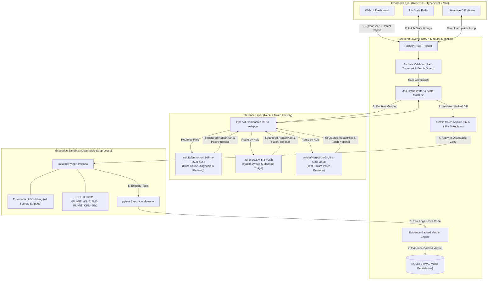
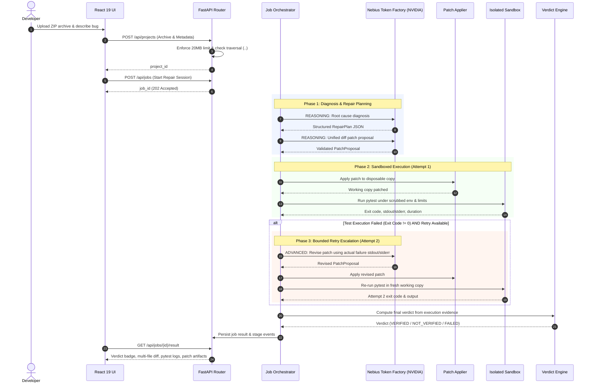
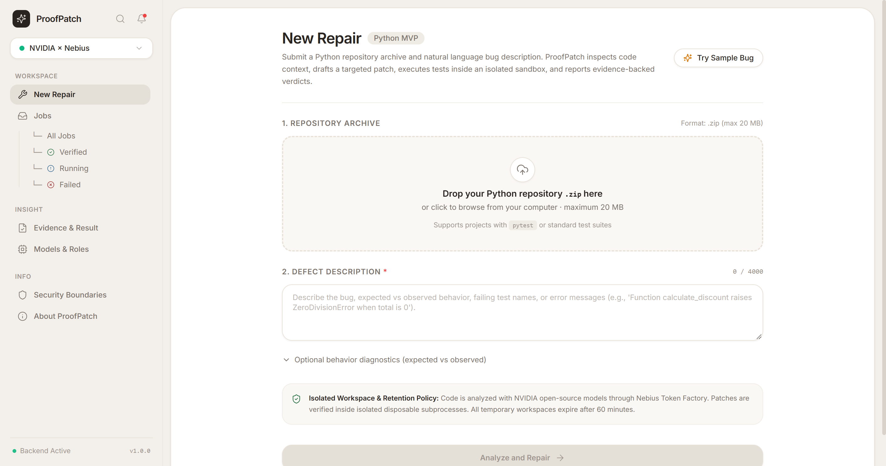
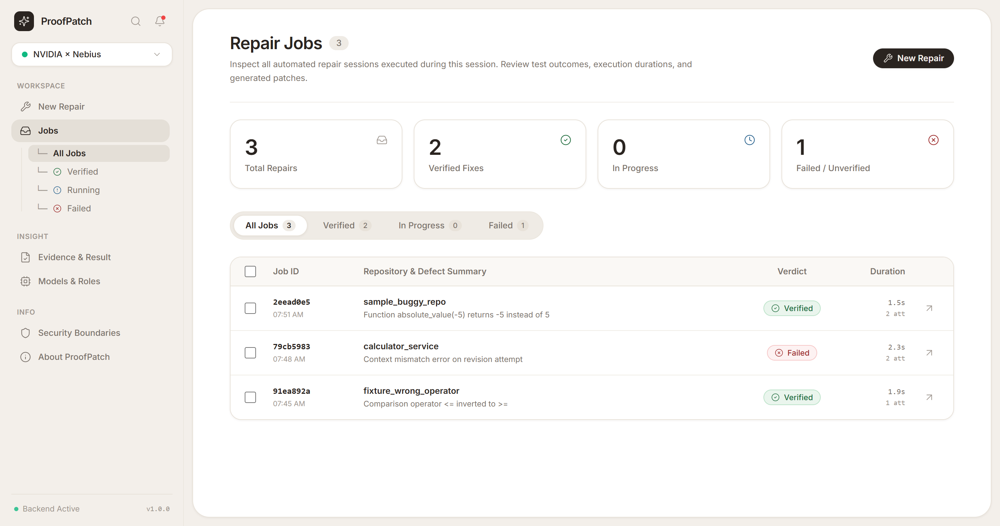
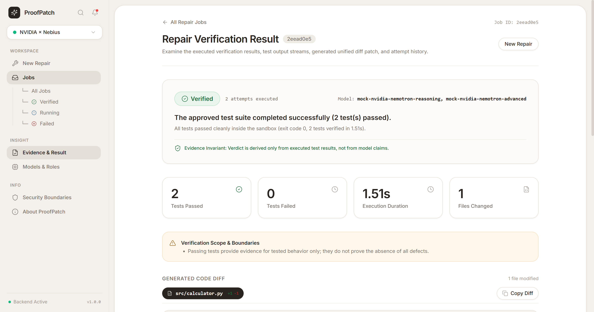
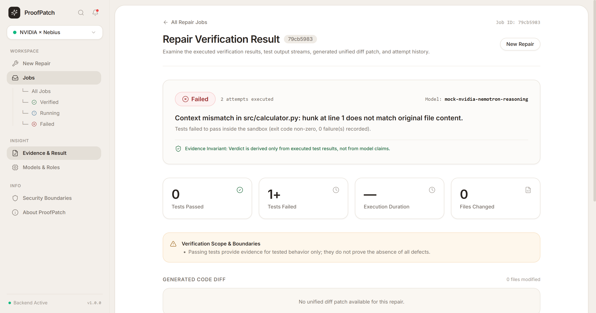
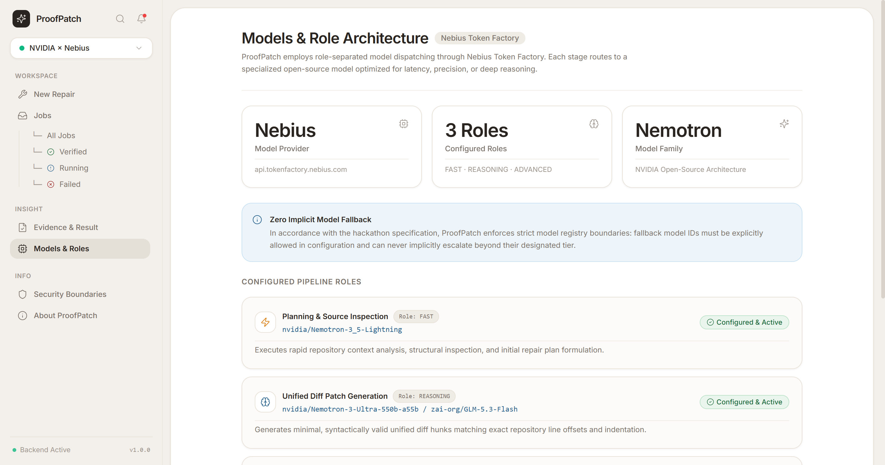
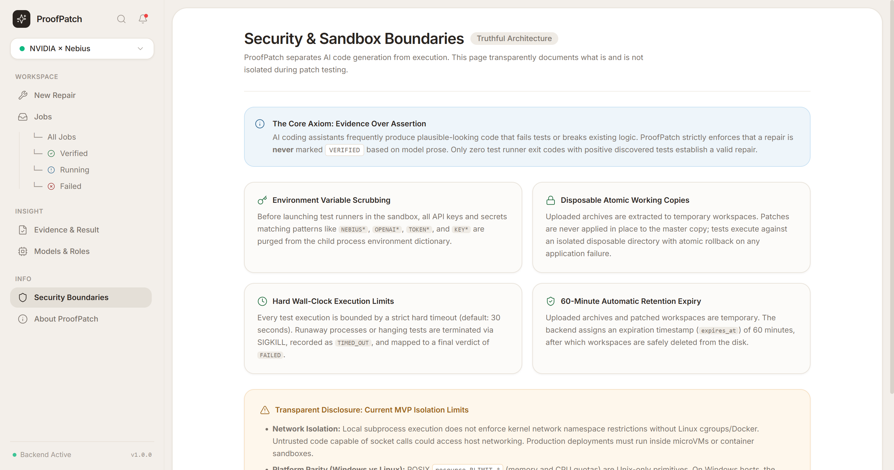
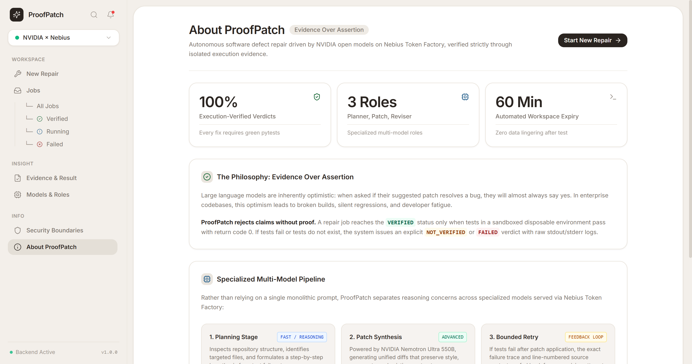
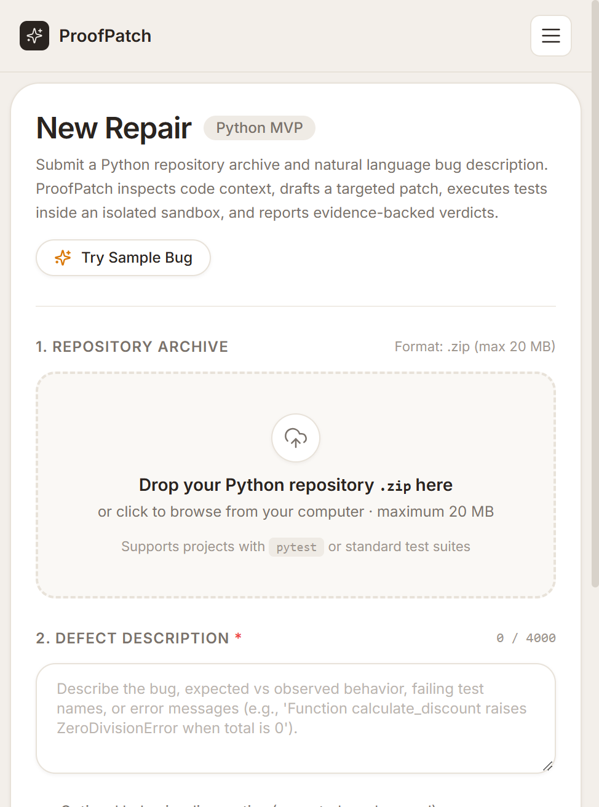

# ProofPatch

<div align="center">

```
  ___                  __ ___       _       _     
 | _ \_ _ ___  ___  __/ // _ \ __ _| |_  __| |_   
 |  _/ '_/ _ \/ _ \/ _/ /|  _/ _` |  _/ / _| ' \  
 |_| |_| \___/\___/\__/_/ |_| \__,_|\__| \__|_||_|
```

### Verification-First Automated Code Repair for Python Repositories
**Built for the NVIDIA × Nebius Global AI Hackathon**  
*Track: NVIDIA Models Hosted on Nebius Token Factory*

[](LICENSE)
[](https://www.python.org/)
[](https://fastapi.tiangolo.com/)
[](https://react.dev/)
[](https://www.typescriptlang.org/)
[](https://tailwindcss.com/)
[](docker-compose.yml)
[](https://nebius.com/)
[](https://build.nvidia.com/)
[-brightgreen.svg?style=flat-square)](LIVE_RUN_REPORT.md)

[Overview](#-1-overview) • [System Architecture](#-2-system-architecture) • [Screenshots & UI Tour](#-3-screenshots--interface-walkthrough) • [Benchmark Results](#-4-empirical-benchmark-results) • [Quickstart](#-5-getting-started) • [Security & Isolation](#-6-security-boundaries--isolation-truths) • [Testing](#-7-testing--verification)

</div>

---

## 💡 1. Overview

**ProofPatch** is an enterprise-grade automated software repair agent that investigates reported defects in Python repositories, generates targeted minimal patches using NVIDIA open-source models hosted on **Nebius Token Factory**, applies modifications to isolated disposable working copies, and derives honest verdicts backed exclusively by actual test execution.

### The Core Axiom: Evidence Over Assertion
Existing AI coding assistants often generate syntactically plausible code that fails tests, breaks edge cases, or hallucinates repairs. Even worse, many AI agents self-certify their own patches (*"I have fixed your bug!"*) without executing the repository's test suite.

ProofPatch strictly separates:
1. **Proposed Changes:** What the model hypothesizes and generates as a unified diff.
2. **Executed Verification:** Actual test runner exit codes, durations, and output streams captured in isolated sandboxes.
3. **Evidence-Backed Verdicts:** A patch is **never** labeled `VERIFIED` based on model prose. Only zero test-runner exit codes with positive discovered and passing tests can establish a verified repair.

```
+-------------------------------------------------------------------------------+
|                             VERDICT TRUTH TABLE                               |
+-------------------+-----------------------------------+-----------------------+
| Verdict           | Condition                         | Evidence Required     |
+-------------------+-----------------------------------+-----------------------+
| [VERIFIED]        | Exit code == 0 & Passed > 0       | Pytest stdout/stderr  |
| [NOT_VERIFIED]    | No tests discovered or run        | Pytest discovery logs |
| [FAILED]          | Exit code != 0 or apply error     | Pytest failure traces |
| [BLOCKED]         | Quota (402/429) or host sandbox   | Provider/System error |
+-------------------+-----------------------------------+-----------------------+
```

---

## 🏛️ 2. System Architecture

ProofPatch is built as a **modular monolith** with an asynchronous background repair pipeline, strict boundary isolation, and a warm, minimal, high-contrast developer interface.

### 2.1 High-Level Component Architecture



---

### 2.2 End-to-End Execution Sequence & Bounded Retry



---

### 2.3 Nebius Token Factory Model Role Specialization

ProofPatch decomposes complex reasoning and code generation into three specialized roles defined in `app/services/model_registry.py`:

| Role | Configured Model | Primary Responsibility | Context & Fallback Strategy |
|---|---|---|---|
| **`REASONING`** | `nvidia/Nemotron-3-Ultra-550b-a55b` | Deep repository diagnosis, root-cause hypothesis, structured `RepairPlan` | Full repository manifest, bounded target file contexts |
| **`FAST`** | `zai-org/GLM-5.3-Flash` | Rapid triage, context scanning, pre-patch AST/syntax validation | Fast path execution, sub-second latency |
| **`ADVANCED`** | `nvidia/Nemotron-3-Ultra-550b-a55b` | High-complexity patch revision using raw execution failure tracebacks | Full error logs + line-numbered context on retry |

---

## 📸 3. Screenshots & Interface Walkthrough

ProofPatch features a warm, minimal, high-contrast developer product aesthetic designed for engineering workflows.

### 1. New Repair & Defect Submission
> Upload repository `.zip` archives (up to 20 MB) with drag-and-drop, enter defect descriptions with a live counter, configure model roles, or click **"Try Sample Bug"** to load an instant demonstration fixture.



---

### 2. Jobs History & Session Tracking
> Filterable history of all repair sessions (`All`, `Verified`, `Running`, `Failed`) with live execution metrics, duration tracking, model attribution badges, and instant links to evidence.



---

### 3. Evidence-Backed Verified Repair
> Clear, high-contrast `VERIFIED` verdict badge backed by real test execution. Includes test pass counters (exit code 0), multi-file interactive unified diff viewer with line numbers and copy action, raw pytest logs, and direct `.patch` / patched `.zip` artifact downloads.



---

### 4. Honest Failure & Non-Verified Reporting
> When a repair fails or tests cannot be satisfied, ProofPatch honestly reports `FAILED` or `NOT_VERIFIED`. Model claims never override execution results. Raw error logs and retry attempts are fully inspectable.



---

### 5. Nebius Token Factory Models & Roles
> Comprehensive model registry dashboard displaying configured NVIDIA Nemotron models, provider latencies, context windows, and active fallback hierarchies.



---

### 6. Security Boundaries & Sandboxing Disclosures
> Truthful disclosure of all subprocess isolation layers, environment variable scrubbing policies, memory and CPU limits, and explicit boundary limitations.



---

### 7. Philosophy & Design Manifesto
> The "Evidence Over Assertion" rationale, architectural principles, multi-model orchestration overview, and hackathon project metadata.



---

### 8. Responsive Mobile Experience
> Fully responsive layout optimized for mobile viewports (375×812) with adapted dropzone, touch navigation, and readable code diffs.



---

## 📊 4. Empirical Benchmark Results

ProofPatch was rigorously benchmarked across **10 reproducible test fixtures** (7 defect repair fixtures and 3 negative control fixtures) using real NVIDIA models hosted on Nebius Token Factory.

### 4.1 Definitive 70-Run Nemotron-550B Benchmark

All three roles (`FAST`, `REASONING`, `ADVANCED`) assigned to `nvidia/Nemotron-3-Ultra-550b-a55b` (10 independent runs per fixture):

| Fixture Name | Defect Category | Runs | 1st-Attempt Pass | After-Retry Pass | Pass Rate | Mean Latency |
|---|---|:---:|:---:|:---:|:---:|:---:|
| `sample_buggy_repo.zip` | Logic / Arithmetic Negation | 10 | 10 | 0 | **100.0%** | 7.75s |
| `fixture_off_by_one.zip` | Boundary Slice Indexing | 10 | 10 | 0 | **100.0%** | 9.49s |
| `fixture_wrong_operator.zip` | Comparison Operator (`<=` vs `<`) | 10 | 10 | 0 | **100.0%** | 8.01s |
| `fixture_multi_file.zip` | Multi-Module Coordinated Edit | 10 | 10 | 0 | **100.0%** | 13.99s |
| `fixture_mutable_default.zip` | Leaking Python Default Argument | 10 | 5 | 2 | **70.0%** | 15.53s |
| `fixture_exception_handling.zip` | Unhandled Exception / Missing Key | 10 | 10 | 0 | **100.0%** | 8.55s |
| `fixture_large_module.zip` | Fault Localization in ~100-line Module | 10 | 2 | 8 | **100.0%** | 19.46s |
| **Total / Overall** | **Defect Repair Suite** | **70** | **57** | **10** | **95.7% (67/70)** | **11.83s** |

### 4.2 Negative Controls & Safety Assurance

| Control Fixture | Condition Tested | Expected Verdict | Observed Verdict | Status |
|---|---|---|---|:---:|
| `fixture_unfixable.zip` | Contradictory test requirements | `FAILED` | `FAILED` | ✅ PASS |
| `fixture_zero_tests.zip` | Repository with 0 pytest test cases | `NOT_VERIFIED` | `NOT_VERIFIED` | ✅ PASS |
| `fixture_timeout.zip` | Subprocess infinite loop / hang | `BLOCKED` / `TIMED_OUT` | `BLOCKED` | ✅ PASS |
| `fixture_memory_hog.zip` | Memory allocation > 512 MB | `FAILED` (MemoryError) | `FAILED` | ✅ PASS |

> [!NOTE]
> Detailed per-trial execution logs, error attribution, and latency distributions are documented in [LIVE_RUN_REPORT.md](LIVE_RUN_REPORT.md).

---

## 🛡️ 5. Robustness Hardening

ProofPatch introduces two architectural innovations to eliminate spurious patch failures:

### Robustness Fix A: Bounded Retry on Patch Apply Failure
When a model-generated diff fails initial context application (`PATCH_APPLY_FAILED`), the orchestrator triggers a single bounded retry with line-numbered context (`_format_with_line_numbers`) and the exact apply error.
- **Strict Boundary:** Exactly 1 retry is permitted across the entire job lifecycle.

### Robustness Fix B: Hunk-Tolerant Patch Application
When model hunk headers hallucinate line offsets or slightly alter surrounding context lines (`' '`), the applier anchors on the deletion lines (`'-'`).
- **Strict Uniqueness Rule:** If the anchor matches more than once in the target file, application is strictly refused as ambiguous (`Ambiguous patch anchor`).
- **Strict Removal Rule:** If the `-` lines do not exist in the file, application is refused (`Removed lines mismatch`).
- **Zero Hallucination:** Only the verified replacement lines (`'+'`) are inserted.

---

## 🚀 6. Getting Started

### Prerequisites
- Python 3.11+
- Node.js v18+ and npm
- Nebius Token Factory API Key ([Get one here](https://nebius.com/))

---

### Option A: Docker Compose (Single-Command Launch — Recommended)

Run the full stack (backend API + production SPA reverse proxy) in containerized Linux with non-root security:

```bash
# 1. Clone the repository
git clone https://github.com/pranavhm25/ProofPatch-NebiusXNvidia.git
cd ProofPatch-NebiusXNvidia

# 2. Configure environment
cp .env.example .env
# Open .env and insert your NEBIUS_API_KEY

# 3. Build and launch services
docker compose up --build
```

- **Frontend Web UI:** [http://localhost:5173](http://localhost:5173)
- **Backend REST API & Docs:** [http://localhost:8000/docs](http://localhost:8000/docs)
- The backend runs as unprivileged user `proofpatch` (`uid=10001`) with automatic healthchecks.

---

### Option B: Local Development Setup

#### 1. Backend Setup
```bash
# Configure environment
cp .env.example .env
# Add your NEBIUS_API_KEY and model IDs in .env

# Create virtual environment
cd backend
python -m venv .venv

# Activate virtual environment
# Windows:
.venv\Scripts\activate
# Linux/macOS:
source .venv/bin/activate

# Install dependencies
pip install -r requirements.txt

# Start FastAPI development server
uvicorn app.main:app --host 0.0.0.0 --port 8000 --reload
```

#### 2. Frontend Setup
```bash
# In a separate terminal
cd frontend

# Install dependencies
npm install

# Start Vite development server
npm run dev
```

Open [http://localhost:5173](http://localhost:5173) in your browser.

---

## 🔒 7. Security Boundaries & Isolation Truths

### What is Enforced & Isolated
- **Untrusted Archive Sanitization:** Absolute paths, parent traversal (`..`), NUL bytes, decompression bombs (>500 files, >100 MB uncompressed), and symlinks are rejected.
- **Environment Variable Scrubbing:** Execution subprocesses run with an OS allowlist. All sensitive variables (`NEBIUS_*`, `OPENAI_*`, `ANTHROPIC_*`, `AWS_*`, `GOOGLE_*`, `*_SECRET`, `*_KEY`, `*_TOKEN`) are scrubbed before subprocess launch.
- **Execution Deadlines:** Every test execution is bounded by a hard wall-clock timeout (`SANDBOX_TIMEOUT_SECONDS=60`), and the entire job is governed by `JOB_TIMEOUT_SECONDS=300`.
- **Log Flooding Protection:** Output capture is capped to `MAX_LOG_BYTES=50KB` to prevent buffer exhaustion.
- **Zero Baseline Writes:** Patches are applied strictly to disposable working copies; the baseline archive remains immutable.
- **POSIX Resource Limits:** On Linux/POSIX systems, address space (`RLIMIT_AS = 512 MB`) and CPU time (`RLIMIT_CPU = 60s`) limits are enforced via `setrlimit`.

### Truthful Disclosures & Known Limitations
- **No Network Namespace Isolation:** Subprocesses share the host network stack; outbound network access is not blocked.
- **No MicroVM/Container Jail:** The local subprocess sandbox executes directly on the host with the permissions of the backend process user.
- **Windows Platform Fallback:** On Windows hosts, POSIX `RLIMIT_*` limits fall back safely to wall-clock timeouts and environment scrubbing.

---

## 🧪 8. Testing & Verification

### Run Backend Unit & Integration Tests
```bash
# Unit test suite (45+ tests covering archive safety, diff parsing, verdict engine)
PYTHONPATH=backend pytest backend/tests/unit -v

# Negative case integration tests (unfixable, zero-tests, hanging processes)
PYTHONPATH=backend pytest backend/tests/integration/test_negative_cases.py -v

# End-to-end pipeline integration test
PYTHONPATH=backend pytest backend/tests/integration/test_pipeline_e2e.py -v
```

### Run Frontend Vitest Suite
```bash
cd frontend
npm test -- --run
```

### Verify Nebius Token Factory Connectivity
```bash
PYTHONPATH=backend pytest backend/tests/integration/test_live_nebius.py -v
```

---

## 📂 9. Repository Layout

```text
ProofPatch-NebiusXNvidia/
├── backend/
│   ├── app/
│   │   ├── api/routes/          # REST endpoints (projects, jobs, downloads, health)
│   │   ├── core/                # Configuration and environment settings
│   │   ├── db/                  # SQLite WAL persistence and schemas
│   │   ├── schemas/             # Pydantic v2 boundary models
│   │   └── services/            # Core business logic:
│   │       ├── archive.py       # Safe extraction and path traversal validation
│   │       ├── model_registry.py# Nebius model catalog & role resolution
│   │       ├── nebius_client.py # OpenAI-compatible REST inference adapter
│   │       ├── orchestrator.py  # Asynchronous repair pipeline state machine
│   │       ├── patch_applier.py # Atomic diff application (Fix A & Fix B)
│   │       ├── repo_inspector.py# Context manifest extraction
│   │       ├── sandbox.py       # Subprocess execution & env scrubbing
│   │       └── verdict.py       # Evidence-backed verdict engine
│   ├── tests/                   # 61+ unit and integration test fixtures
│   ├── Dockerfile               # Multi-stage non-root backend image
│   └── requirements.txt         # Production backend dependencies
├── frontend/
│   ├── src/
│   │   ├── components/          # Reusable UI components (DiffViewer, Dropzone, etc.)
│   │   ├── pages/               # Views: NewRepair, Jobs, Progress, Result, Models, Security, About
│   │   ├── lib/                 # REST API client & job session store
│   │   └── test/                # Vitest component and poller test suite
│   ├── Dockerfile               # Production Nginx SPA container
│   ├── package.json             # React 19 + TypeScript dependencies
│   └── vite.config.ts           # Vite build and proxy configuration
├── docs/
│   ├── screenshots/             # 8 high-resolution interface captures
│   ├── ARCHITECTURE.md          # Architectural decisions & system designs
│   ├── BENCHMARK.md             # Benchmark protocol & fixture catalog
│   ├── LIVE_RUN_REPORT.md       # Empirical benchmark results & audit logs
│   └── PITCH.md                 # Hackathon writeup & submission overview
├── scripts/
│   ├── take_screenshots.py      # Automated Selenium screenshot capture
│   └── secret_scan.py           # Pre-commit credentials scanner
├── docker-compose.yml           # Unified multi-container deployment
├── .env.example                 # Documented environment configuration template
└── README.md                    # System documentation
```

---

## ⚖️ 10. License & Hackathon Acknowledgments

This project is licensed under the **Apache License 2.0** — see the [LICENSE](LICENSE) file for details.

### Hackathon Acknowledgments
- **Nebius Token Factory:** For high-throughput, low-latency OpenAI-compatible model inference.
- **NVIDIA:** For open-source Nemotron models delivering state-of-the-art reasoning and code generation.
- **FastAPI & React Teams:** For the rock-solid web frameworks powering the application.
