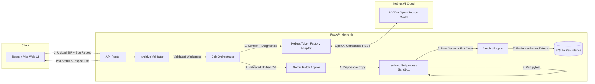

# ProofPatch

> **Verification-First Automated Code Repair for Python Repositories**  
> *Built for the NVIDIA × Nebius Global AI Hackathon*

---

## 1. Overview

**ProofPatch** is a verification-first coding agent that investigates reported defects in Python repositories, generates targeted minimal patches using NVIDIA open-source models hosted on **Nebius Token Factory**, applies changes to isolated working copies, and derives honest verdicts backed exclusively by actual test execution.

### The Core Axiom: Evidence Over Assertion
AI coding assistants often produce plausible-looking patches that fail tests, break existing functionality, or hallucinate fixes. ProofPatch strictly separates:
1. **Proposed Changes:** What the model suggests changing and why.
2. **Executed Verification:** Actual test runner exit codes, durations, and output streams.
3. **Claims Supported by Evidence:** A patch is **never** labeled `VERIFIED` based on model prose. Only zero exit codes with positive discovered test cases can establish a verified repair.

---

## 2. Architecture & Workflow



### Repair Lifecycle
1. **Upload & Inspection:** Users upload a `.zip` Python archive (max 20 MB). Traversal attacks (`..`), symlinks, caches, and secret files are rejected/excluded.
2. **Diagnosis & Planning:** The NVIDIA model produces a structured `RepairPlan` with root-cause hypothesis and target files.
3. **Patch Generation:** Model returns a unified diff patch (`PatchProposal`), validated for size and target paths.
4. **Isolated Execution:** Pytest runs inside a sandboxed subprocess with environment scrubbing (all API keys removed) and resource limits.
5. **Bounded Retry:** If tests fail, exactly one retry is attempted by passing actual stdout/stderr failure logs back to the model.
6. **Verdict & Export:** Verdict (`VERIFIED`, `NOT_VERIFIED`, `FAILED`, `BLOCKED`) is computed. Users can inspect diffs, test logs, and download `.patch` or patched `.zip` files.

---

## 3. Tech Stack

| Layer | Technology | Purpose |
|---|---|---|
| **Frontend** | React 19, TypeScript, Vite, Tailwind CSS | High-contrast, evidence-driven developer UI |
| **Backend** | Python 3.11+, FastAPI, Pydantic v2 | Async REST API & strict boundary validation |
| **Persistence** | SQLite 3 (WAL mode) | Relational job, attempt, and event metadata |
| **Model Platform** | Nebius Token Factory | OpenAI-compatible REST inference for NVIDIA models |
| **Model Family** | NVIDIA Open-Source (e.g., Nemotron) | Low-variance planning and patch generation |
| **Test Runner** | pytest | Automated test execution |

---

## 4. Getting Started

### Prerequisites
- Python 3.11+
- Node.js v18+ and npm
- Nebius Token Factory API key and configured role model IDs

### 1. Backend Setup
```bash
# Clone repository
git clone https://github.com/pranavhm25/ProofPatch-NebiusXNvidia.git
cd ProofPatch-NebiusXNvidia

# Configure environment
cp .env.example .env
# Set NEBIUS_API_KEY and the three role model IDs in .env.
# Confirm IDs with the authenticated Token Factory catalog before use.

# Install backend dependencies
cd backend
pip install -r requirements.txt

# Start FastAPI server
uvicorn app.main:app --host 0.0.0.0 --port 8000 --reload
```

### 2. Frontend Setup
```bash
# In a new terminal window
cd frontend

# Install dependencies
npm install

# Start development server
npm run dev
```
Open [http://localhost:5173](http://localhost:5173) in your browser.

### 3. Web UI & Evidence Interface
ProofPatch features a warm, minimal, calm developer product aesthetic matching modern engineering standards:
- **New Repair (/):** Drag-and-drop repository .zip archive upload (max 20 MB), natural language defect report with live character counter, optional diagnostics, and 1-click sample bug loader (Try Sample Bug).
- **Jobs History (/jobs):** Filterable list of repair sessions (All, Verified, Running, Failed) with duration metrics, model attribution badges, and quick links.
- **Progress Timeline (/jobs/:id):** Real-time 7-stage execution timeline tracking validation, inspection, planning, patch synthesis, sandbox testing, and retry.
- **Evidence & Result (/jobs/:id/result):** Evidence-backed verdict badge (VERIFIED, NOT_VERIFIED, FAILED, BLOCKED), multi-file unified diff viewer with line numbers and copy action, raw pytest stdout/stderr logs, attempt breakdown, and direct .patch / patched .zip artifact downloads.
- **Models & Roles (/models):** Architecture and latency synthesis for Nebius Token Factory roles (FAST, REASONING, ADVANCED).
- **Security Boundaries (/security):** Truthful disclosure of subprocess isolation, environment variable scrubbing, 60-minute workspace expiration, and network boundary limits.
- **About (/about):** The evidence-over-assertion philosophy and multi-model orchestration overview.

---

## 5. Testing & Verification

### Run Frontend Tests
Execute the Vitest component and poller test suite:
`ash
cd frontend
npm test -- --run
`

### Run Backend Unit Tests
Execute the comprehensive test suite covering archive traversal protection, atomic patch application, verdict logic, and REST endpoints:
```bash
PYTHONPATH=backend pytest backend/tests/unit -v
```

### Verify Token Factory Connectivity
The optional live check compares every configured model ID with the account's
authenticated `/models` catalog and makes one real inference request using the
configured reasoning model. It requires the API key and role IDs in `.env` and
may consume credits:
```bash
PYTHONPATH=backend pytest backend/tests/integration/test_live_nebius.py -v
```

### Sample Bug Fixture
A pre-packaged buggy repository is available at:
`backend/tests/fixtures/sample_buggy_repo.zip`  
Contains a known off-by-logic bug in `absolute_value(-15) == 15` ready for demonstration and verification.

---

## 6. Security Boundaries & Isolation Truths

### What is Isolated & Enforced
- **Untrusted Archive Handling:** Uploaded .zip archives are treated as untrusted input. Directory traversal (..), absolute paths, NUL bytes, decompression bombs (>500 files, >100 MB uncompressed), and symlinks are rejected. Secret files and cache directories are excluded from context manifests.
- **Environment Variable Scrubbing:** Execution subprocesses run with a strict OS allowlist (PATH, TEMP, HOME, etc.). All sensitive variables matching prefixes (NEBIUS, OPENAI, ANTHROPIC, AWS, GOOGLE_, SECRET, TOKEN, KEY, DATABASE, GITHUB_, HF_, etc.) or exact secret names are scrubbed.
- **Execution Deadlines:** Every test run is bounded by a hard wall-clock timeout (SANDBOX_TIMEOUT_SECONDS, default 60s), and the entire job is governed by JOB_TIMEOUT_SECONDS (default 300s).
- **Log Flooding Protection:** Output capture is capped to MAX_LOG_BYTES (default 50 KB) to prevent log buffer exhaustion.
- **Zero Baseline Writes:** Patches are applied strictly to disposable working copies; failures discard the copy and leave the baseline upload immutable.
- **POSIX Resource Limits:** On Linux/POSIX systems, address space (RLIMIT_AS) and CPU time (RLIMIT_CPU) limits are applied where supported via setrlimit.

### What is NOT Isolated (Known Limitations)
- **No Network Isolation:** Subprocesses share the host network stack; outbound network egress is NOT blocked (no network namespace or packet filtering).
- **No Container / Chroot Jail:** The local_process sandbox executes directly on the host operating system with the permissions of the backend process user. It does not provide container or namespace virtualization.
- **Non-POSIX Platforms:** On Windows hosts, POSIX RLIMIT_* limits are unavailable; execution relies on wall-clock timeout and environment scrubbing.
---

## 7. License

This project is licensed under the Apache 2.0 License - see the [LICENSE](LICENSE) file for details.
