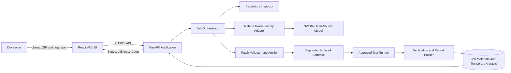
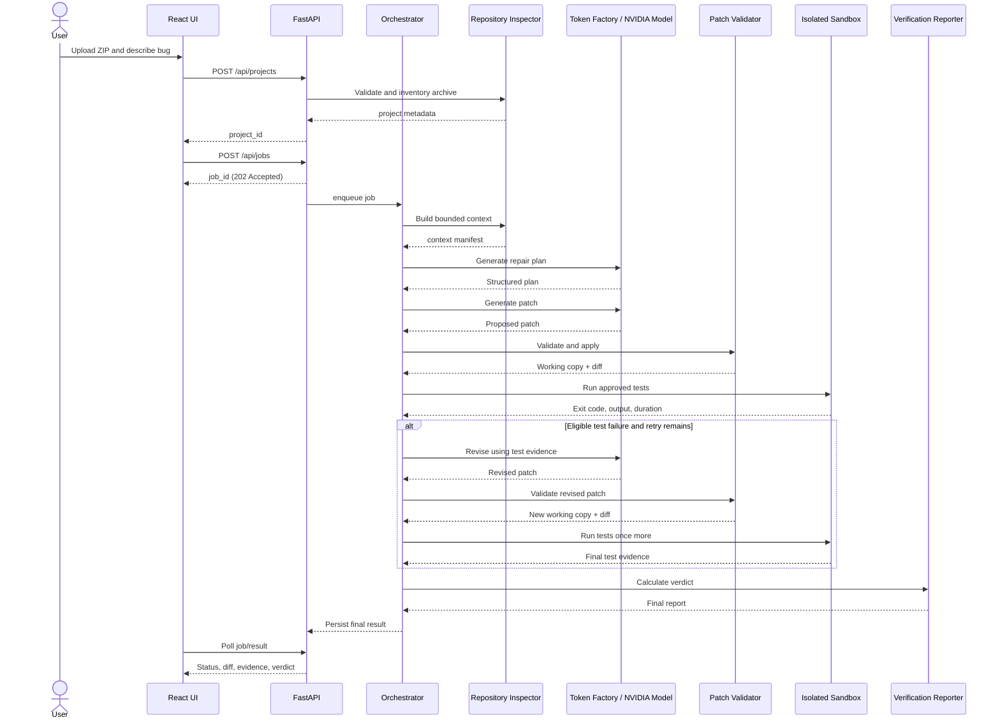

# ProofPatch — System Architecture

**Version:** 1.0  
**Architecture style:** Modular monolith with an asynchronous job pipeline

## 1. Architectural Overview

ProofPatch uses a React frontend, a FastAPI backend, a model-provider adapter, a sandbox adapter, and a verification/reporting layer. The backend is intentionally a modular monolith: the team can deploy and debug one application without the operational overhead of multiple services.

The long-running repair pipeline is represented as a job with explicit state transitions. The API acknowledges a job quickly, while the frontend polls for status. Server-sent events can be added later if they are easy to implement without destabilizing the MVP.

## 2. Context Diagram

## 3. Component Responsibilities

### 3.1 Web UI
- Upload ZIP and collect bug report.
- Present validation messages.
- Start a job and display its ID.
- Poll job state and render progress.
- Display repair plan, diff, test evidence, attempt history, and final verdict.
- Request patch/archive download.
- Never store or receive the Nebius API key.

### 3.2 API layer
- Validate request shapes and session/job associations.
- Enforce upload limits.
- Return stable JSON response contracts.
- Create jobs and expose status/results.
- Apply rate limiting or submission limits suitable for a public demo.
- Avoid blocking request handlers while repair/test work is running.

### 3.3 Job orchestrator
- Own the state machine.
- Coordinate repository analysis, model calls, patch validation, sandbox execution, retry, and reporting.
- Enforce total time and attempt budgets.
- Record stage events.
- Stop on safety, authentication, or infrastructure errors that cannot be safely retried.

### 3.4 Repository inspector
- Safely extract the archive.
- Build a file inventory.
- Exclude secrets, generated files, binaries, caches, and large files.
- Select bounded relevant context.
- Produce a compact repository map and context manifest.

### 3.5 Nebius provider adapter
- Encapsulate endpoint, authentication, model ID, request settings, and provider-specific error mapping.
- Validate structured model responses.
- Record model ID and prompt version.
- Apply capped retries only to transient provider failures.
- Never return provider secrets to callers or logs.

### 3.6 Patch validator/applier
- Validate schema, paths, patch size, and changed-file count.
- Reject unsafe target locations.
- Apply changes only to a disposable working copy.
- Produce a unified diff and hash.
- Preserve the original source baseline.

### 3.7 Sandbox adapter
- Encapsulate the exact supported execution API.
- Create isolated execution context for a job/attempt.
- Submit only the validated working copy and approved command.
- Collect output, exit code, timeout and execution metadata.
- Enforce or request platform-supported resource restrictions.
- Clean up temporary execution artifacts.

The adapter must be implemented against verified documentation and account capabilities. The architecture does not assume an endpoint or API method that has not been confirmed.

### 3.8 Verification/report builder
- Parse test output conservatively.
- Compute status from test-runner evidence.
- Record tests discovered/executed, exit code, duration, and warnings.
- Produce a stable result contract.
- Explicitly report no-tests, timeout, infrastructure error, and failed tests.

### 3.9 Persistence
- SQLite or a similarly lightweight store for job metadata and stage events.
- Temporary filesystem/object storage for source, patch, and export artifacts.
- Source retention is short and configurable.
- Do not store full repository contents in the job database.

## 4. Sequence Diagram

## 5. Data Flow and Trust Boundaries

### Trust boundary A: Browser to API
All browser inputs are untrusted. Validate size, shape, origin, and session/job association. Never accept client-supplied filesystem paths or commands.

### Trust boundary B: Uploaded repository to model
Repository files may contain prompt-injection text, secrets, malicious code, or misleading documentation. Treat source as untrusted data. Filter secrets and irrelevant files, delimit source clearly, and never allow repository instructions to override application policy.

### Trust boundary C: Model output to application
Model output is untrusted. Validate it against schemas and policy. The model cannot choose arbitrary commands, sandbox settings, paths, or final status.

### Trust boundary D: Application to execution sandbox
The sandbox is the only place where repository code and tests may execute. Send no provider secrets or host credentials. Limit network access and resources according to the platform's supported controls.

### Trust boundary E: Generated artifact to user download
Validate output archive paths and content before download. Do not allow a job ID or filename to become an arbitrary file-read path.

## 6. Failure Domains

| Failure | Detection | Expected response |
|---|---|---|
| Invalid ZIP | Archive validator | Reject before job creation |
| Unsupported project | Project detector | Explain supported Python scope |
| Model rate limit | Provider adapter | Capped backoff or `BLOCKED` |
| Malformed model output | Schema validator | Record failure; no patch application |
| Unsafe patch path | Patch validator | Reject patch |
| Sandbox unavailable | Sandbox adapter | `BLOCKED`, no false success |
| Test timeout | Sandbox result | `TIMED_OUT`, bounded cleanup |
| No tests found | Test parser | `NOT_VERIFIED` |
| Retry fails | Orchestrator | Preserve both attempts; `FAILED` or `NOT_VERIFIED` |
| Export failure | Export module | Keep report available; explain download failure |

## 7. Deployment Topology

Preferred MVP topology:
- Static frontend on a suitable free static host.
- FastAPI backend on a free service that supports the required runtime and execution flow.
- Nebius Token Factory as the inference provider.
- The verified platform sandbox for code execution.
- Lightweight metadata database and ephemeral workspaces.

Do not assume that a free host can run arbitrary containers or maintain local storage. Verify host terms and capabilities. If the sandbox requires direct connectivity or a particular runtime, adapt the backend deployment to the supported arrangement.

## 8. Scaling Strategy

The MVP is designed for a small number of concurrent demo users. Use bounded concurrency, request-size limits, job timeouts, and per-session limits. If demand increases, a separate queue/worker and durable artifact store can be introduced later. These are not MVP requirements.

## 9. Architectural Decisions

1. **Modular monolith:** faster development and easier integration.
2. **One model first:** reduces complexity and inference cost.
3. **Python-only:** limits parser and test-runner scope.
4. **One retry:** demonstrates iterative behavior without unbounded cost.
5. **Evidence-based verdict:** prevents model-generated claims from becoming product truth.
6. **Adapter for sandbox:** allows the verified provider API to be implemented without coupling orchestration to an unconfirmed endpoint.
7. **Temporary source retention:** minimizes privacy and storage risk.
8. **No autonomous external write actions:** keeps the demo reviewable and safe.
