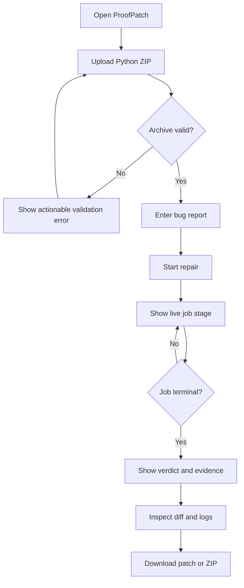

# ProofPatch — Product Design Specification

**Version:** 1.0  
**Design direction:** Technical, calm, evidence-led, minimal  
**Primary users:** Developers reviewing an automated repair  
**Primary action:** Submit a repository and inspect a repair result

## 1. Design Goals

1. Make the workflow understandable without a tutorial.
2. Keep the difference between AI-generated proposals and executed evidence visually explicit.
3. Surface failure states as clearly as success states.
4. Prioritize code readability and diff inspection over decorative dashboard elements.
5. Make the demo feel like a usable developer tool rather than a marketing landing page.
6. Keep the interface accessible, responsive, and quick to scan.

## 2. Information Architecture

Primary application areas:
- **New repair:** Upload a project and describe a defect.
- **Repair progress:** Track job stage and current action.
- **Repair result:** Review verdict, test evidence, changed files, diff, logs, and exports.
- **About / technical details:** Explain model attribution, Nebius integration, limitations, and privacy behavior.

Do not add a complex dashboard, user management, organization settings, or billing interface to the MVP.

## 3. Main User Flow

## 4. Screen Specifications

### 4.1 Landing / New Repair

**Purpose:** Start a repair with minimal friction.

Elements:
- Wordmark: ProofPatch.
- Short statement: “Repair code. Verify the change.”
- One-paragraph explanation: ProofPatch proposes a patch, runs tests in an isolated environment, and reports what the tests actually establish.
- ZIP dropzone with browse action.
- Supported format and upload limit.
- Privacy note describing processing and temporary retention.
- Disabled state until a valid file is selected.
- After validation, show project name, file count, and detected language.
- Bug report textarea.
- Optional expected/observed behavior fields, collapsed or visually secondary.
- Primary CTA: “Analyze and repair”.
- Small technical note identifying the configured NVIDIA model through Nebius Token Factory after configuration is confirmed.

Avoid unsupported claims such as “guaranteed fix,” “fully secure,” or “zero bugs.”

### 4.2 Progress Screen

Show:
- Job ID in copyable form.
- A vertical stage timeline:
  1. Validating repository
  2. Inspecting source
  3. Planning repair
  4. Generating patch
  5. Running tests
  6. Optional retry
  7. Preparing report
- Current stage highlighted.
- Completed stages use a neutral completed indicator.
- Failed or blocked stages show a distinct warning/error state.
- Safe progress message and elapsed time.
- Cancel action only if cancellation is implemented reliably.
- No fake percentages derived from elapsed time. If a percentage is shown, label it approximate.

### 4.3 Result Screen

Header:
- Verdict label: `VERIFIED`, `NOT VERIFIED`, `FAILED`, or `BLOCKED`.
- One-sentence explanation.
- Model/provider attribution and total attempts.

Summary cards:
- Tests passed / failed / discovered.
- Duration.
- Changed files.
- Attempts.

Main sections:
1. **What changed:** short model-generated summary, explicitly labeled as explanation.
2. **Test evidence:** actual command identifier, exit code, duration, test output.
3. **Code diff:** unified diff with syntax highlighting and file navigation.
4. **Attempt history:** initial attempt and optional retry.
5. **Limitations:** no-tests, timeout, truncated output, incomplete verification, or other warnings.
6. **Export:** download patch and patched ZIP.

The verdict must be calculated by the backend and never inferred from the summary text.

### 4.4 Error and Empty States

Examples:
- Invalid ZIP: explain accepted format and how to create a ZIP without a parent-directory wrapper if needed.
- Unsupported project: state that the MVP currently supports Python projects.
- Provider unavailable: explain that model access is temporarily unavailable and no repair was verified.
- Sandbox unavailable: explain that execution could not be completed; do not show a success badge.
- No tests found: explain that the code may have been changed but the system could not establish a verified fix.
- Test failure: show failing test output and the retry count.
- Expired artifact: explain that temporary files have expired and the user must upload again.

## 5. Visual System & Design System Tokens

ProofPatch follows a **warm, minimal, calm developer product aesthetic** derived from the reference visual standard:
- **Base Canvas:** Warm off-white (#F3EFEA) providing high contrast without screen glare.
- **Navigation:** Persistent 260px sidebar (#ECE7E1) with nested tree items (└─ branch indicator), brand mark, workspace picker pill, and system status indicator.
- **Primary Panel:** Elevated clean white surface (#FFFFFF) with 24px corner radius (
ounded-3xl), 1px subtle warm border (#E8E2D9), and soft shadow (shadow-soft).
- **Typography:** Inter for clear readable interface text, JetBrains Mono for code blocks, line numbers, and cryptographic hashes.

### 5.1 Color Tokens

| Semantic Token | Value | Hex | Description |
|---|---|---|---|
| --warm-bg | warm-bg | #F3EFEA | Page backdrop canvas |
| --warm-panel | warm-panel | #ECE7E1 | Persistent sidebar background |
| --warm-card | warm-card | #FFFFFF | Main floating workspace container |
| --warm-border | warm-border | #E8E2D9 | 1px card and separator border |
| --warm-border-subtle | warm-border-subtle | #E4DFD7 | Inner section divider line |
| --warm-muted | warm-muted | #E2DDD5 | Active nav link & button hover |
| --warm-pill | warm-pill | #EDE9E2 | Inactive tab pill background |
| --ink-primary | ink-primary | #2A2420 | Primary text and primary CTA buttons |
| --ink-secondary | ink-secondary | #7A726B | Labels, descriptions, secondary copy |
| --ink-muted | ink-muted | #9E968F | Timestamps, counters, icons |

### 5.2 Verdict Badges & Accessible States
To ensure accessibility, color is never used as the sole indicator of status. Every badge pairs a unique icon with title-case text:

| Verdict / Status | Background | Text | Border | Icon |
|---|---|---|---|---|
| VERIFIED | #EAF5ED | #1E6B3C | #BDE3CA | CheckCircle2 |
| NOT_VERIFIED | #FEF7EC | #9A6218 | #F7DFC0 | AlertCircle |
| FAILED | #FDF2F2 | #9C2A2A | #F6C8C8 | XCircle |
| BLOCKED | #F4F1ED | #5A534D | #DDD7CF | ShieldAlert |
| RUNNING | #EEF5FA | #27618D | #C8E1F3 | Loader2 (spinning) |

### 5.3 Component Inventory

1. **PageHeader (src/components/PageHeader.tsx):**
   - Title text with bold tracking.
   - Count badge pill (inline-flex px-2.5 py-0.5 rounded-full bg-warm-pill text-xs).
   - Descriptive paragraph and trailing action button slot.

2. **StatCard (src/components/StatCard.tsx):**
   - High-contrast 3xl metric number.
   - Secondary label underneath.
   - Top-right icon container with muted tone.
   - Optional bottom hint line separated by subtle border.

3. **PillTabs (src/components/PillTabs.tsx):**
   - Horizontal tab bar matching the reference screenshot filter controls.
   - Active tab: white background, 1px #E8E2D9 border, shadow-soft, dark ink text.
   - Inactive tab: tinted #EDE9E2 background, muted ink text.

4. **Sidebar Navigation (src/components/layout/Sidebar.tsx):**
   - 260px desktop width; responsive sliding drawer on mobile with backdrop blur.
   - Workspace dropdown pill with live backend indicator dot.
   - Grouped sections: Workspace, Insight, Info.
   - Nested sub-items under Jobs with tree connectors (└─ All Jobs, └─ Verified, etc.).

5. **DiffViewer (src/components/DiffViewer.tsx):**
   - Multi-file tab selector with green/red modification pills (+1 -1).
   - Line-numbered hunk rendering with green additions and red deletions.
   - Copy unified diff button with clipboard feedback.
   - Direct download actions for .patch and patched repository .zip.

6. **TestEvidencePanel & LogPanel (src/components/TestEvidencePanel.tsx):**
   - Collapsible monospace terminal viewer with command ID and execution time.
   - Explicit truncation indicator for large test logs.

7. **Toast Notifications (src/components/Toast.tsx):**
   - Floating notifications anchored to the bottom-right for validation, upload, and clipboard events.

## 6. Interaction Rules

- Primary action is disabled until required inputs are valid.
- While a job is active, prevent accidental duplicate submission.
- Polling failures must not erase the last known job state.
- On browser refresh, the UI should be able to reload the job by ID if session association permits.
- Use optimistic UI only for local actions such as selecting a file; never optimistically mark backend stages complete.
- Diff and logs should remain accessible after the job ends.
- Copy actions show confirmation.
- Downloads show a clear error if the artifact has expired.
- Model-generated text is rendered as plain text or sanitized Markdown; never execute HTML from model output.

## 7. Accessibility

- Full keyboard operation.
- Visible focus indicators.
- Form controls have explicit labels.
- Status changes are announced through an accessible live region.
- Contrast meets WCAG AA where feasible.
- Do not rely on color alone.
- Provide a non-color indicator for diff additions/deletions.
- Support reduced motion.
- Ensure dialogs, if any, manage focus correctly.

## 8. Content and Microcopy

Preferred language:
- “Tests passed” rather than “The fix is guaranteed.”
- “Verification incomplete” rather than hiding missing evidence.
- “The sandbox could not run the test command” rather than a generic “Something went wrong.”
- “Proposed repair” for model output.
- “Executed test result” for measured evidence.

Avoid:
- Unsupported performance claims.
- Claims of total security.
- Overly anthropomorphic agent language.
- Statements that imply the model itself executed tests when the sandbox did.
- Fake progress or invented benchmark values.

## 9. Demo Presentation

Recommended demo sequence (under three minutes):
1. 0:00–0:15 — State the defect and explain the verification-first approach.
2. 0:15–0:35 — Upload a prepared Python project and submit the bug report.
3. 0:35–1:10 — Show the model-powered plan and proposed patch.
4. 1:10–1:45 — Show actual sandbox test output and the retry if applicable.
5. 1:45–2:20 — Inspect the diff and evidence-backed verdict.
6. 2:20–2:45 — Explain Token Factory/NVIDIA integration, safety boundaries, and limitations.

Use a prepared scenario that is known to work. If showing a failed scenario, clearly distinguish it from the main successful demo. Do not edit the video to imply an unperformed test ran successfully.
